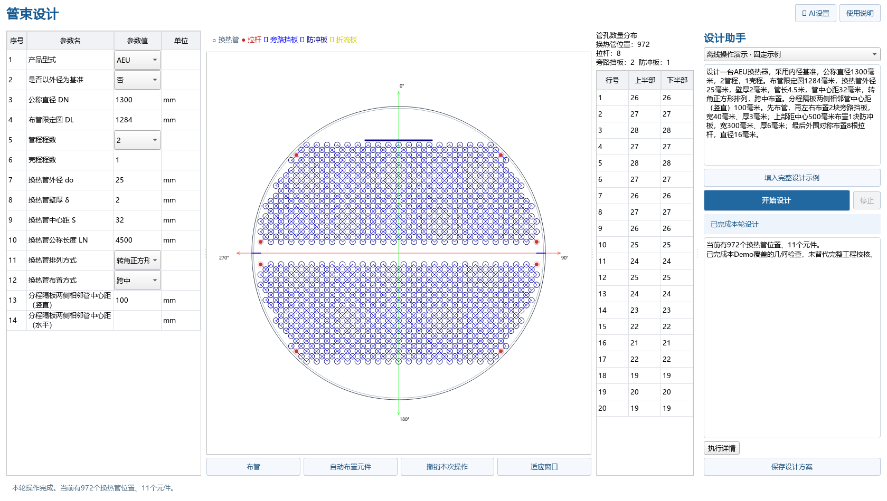

# 管束设计助手 Demo

为设计人员准备的独立管束页面：左侧参数、中间布管图、右侧管孔统计与设计助手。

**双击本目录的 `启动管束设计助手.cmd`。**

- 第一次使用：右上角“AI设置”粘贴阿里云百炼密钥，可选择加密记住。
- 写一句设计要求，点“开始设计”，助手会自动填参、布管、再布置元件。
- 想先看效果：选“离线操作演示”，点“填入完整设计示例”→“开始设计”，不联网。
- 想测试不同设计：打开 [完整设计测试示例.txt](完整设计测试示例.txt)，每次复制一组到“百炼AI”模式。
- 不满意可撤销，满意可保存方案。参数也能手改。

[设计人员操作手册](docs/操作手册.md) · [完整设计测试示例](完整设计测试示例.txt) · [设计与实施记录](docs/设计与实施记录.md)

本目录须与 `DongLanpec` 同级：复用其布管算法，不连接原产品数据库。支持内径基准、1/2管程，以及拉杆、旁路挡板、防冲板的Demo几何布局；未替代完整生产规范与强度校核。

2026-10-21：所有AI支持代码已独立放在本 Demo 的 `ai_support/`。DongLanpec 交付项目中的助手入口、助手目录、旧演示启动器、测试和文档均已迁出；历史版本存放在 `legacy_demo/` 供查阅恢复。

百炼模式使用真实Function Calling多轮工具循环；离线模式用固定脚本调用同一套真实工程工具，不冒充模型解析。未取得你的密钥进行真实API验收，首次联网需在本地配置。
